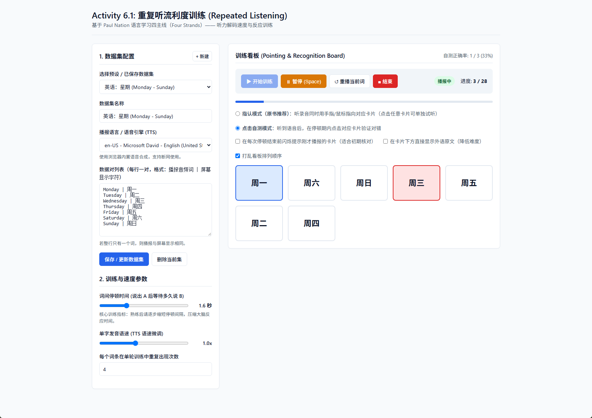

# 流利度练习

## 产地
呃，gemini 4 Argon直接产的（生产日期2026.10.14）。  
用了一下发现能直接用。  
你自己看[对话链接](https://share.gemini.google/vAmBH7tXSC1R)好吧。  

## 理论依据

Paul Nation的《学语言你需要知道什么》（详情见[此](https://github.com/ramen-curator/nation-foreign-language-guide-zh)）里提到的 “活动 6.1：重复听 (Activity 6.1: Repeated listening)”。  

> **活动 6.1：重复听 (Activity 6.1: Repeated listening)**
>
> 找人以外语随机读出一到十的数字并录音，例如：6, 3, 8, 1, 7, 10, 2, 9, 4, 5, 3, 10, 3, 6。每个数字都应该在不同的地方出现几次，这样你就有充分的机会一遍又一遍地听到同一个数字，而不知道它什么时候会出现。在一张纸上按顺序写下 1 到 10，当你听录音时，用手指着你听到的数字。当你能慢速轻松做到时，提高速度再做一次。坚持这样做，直到你能轻松听出这些数字的读音。最好将练习分散在几天内进行，而不是集中在一次做完。
>
> 这项活动利用了重复和提高速度，能快速培养理解数字的流利度。你也可以用它来练习星期、月份、问候语、食物名称以及许多其他内容。

## 快速一览

## 效果演示

https://github.com/user-attachments/assets/0f90062f-9140-49dd-9a3c-6a712f063a8e

